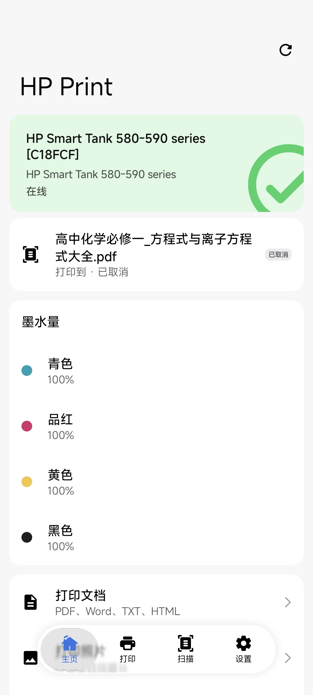
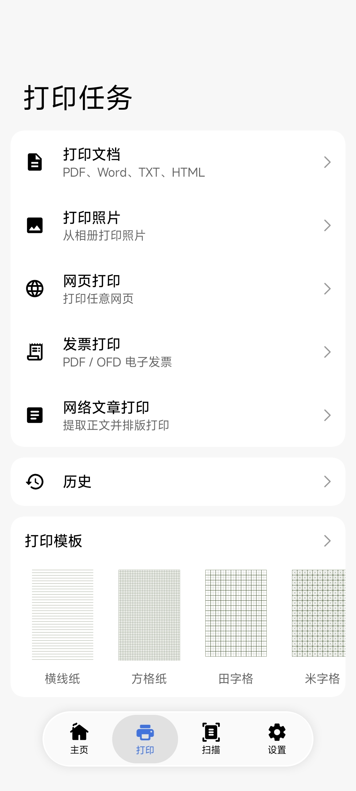
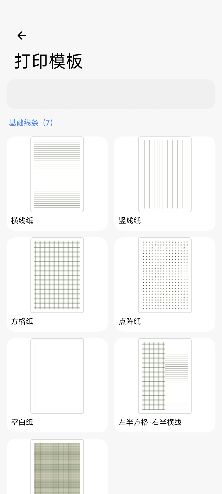
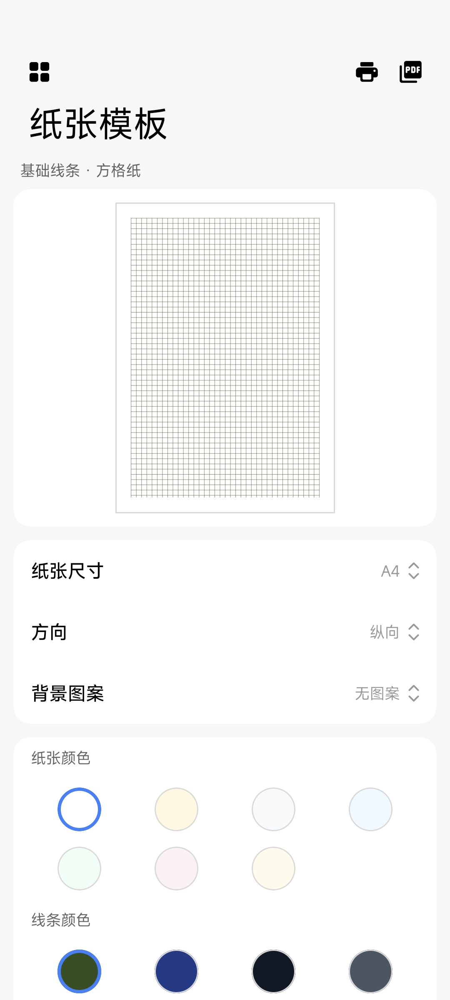
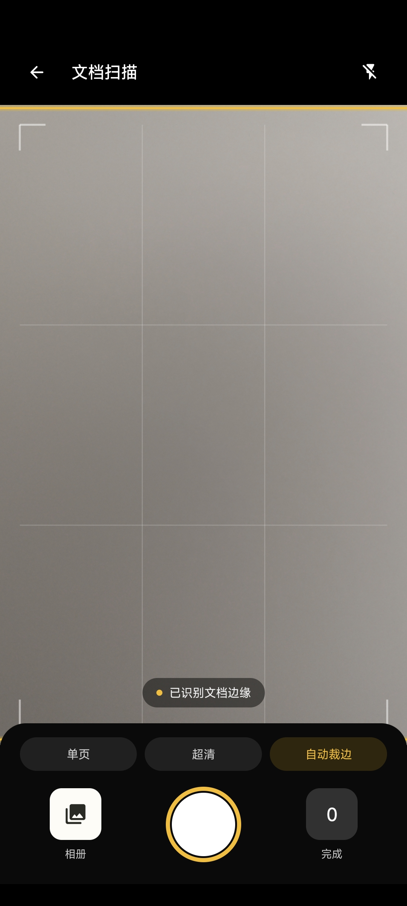
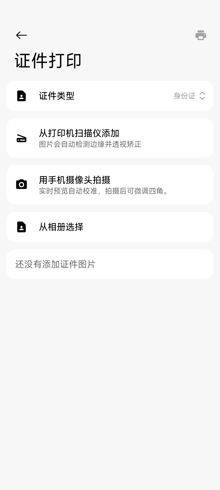
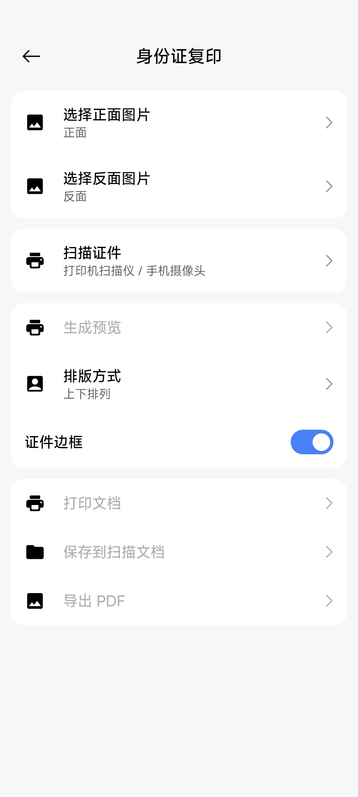
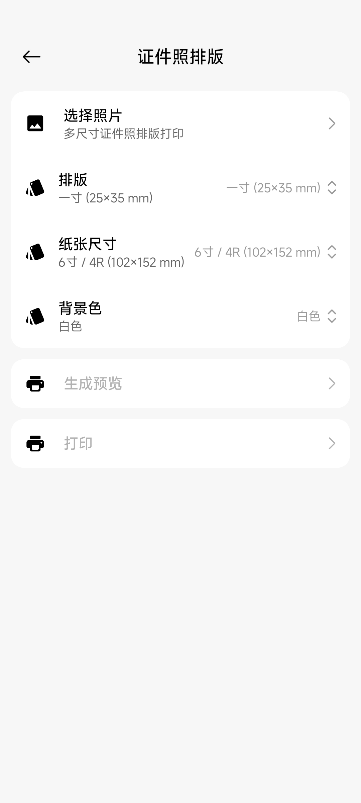
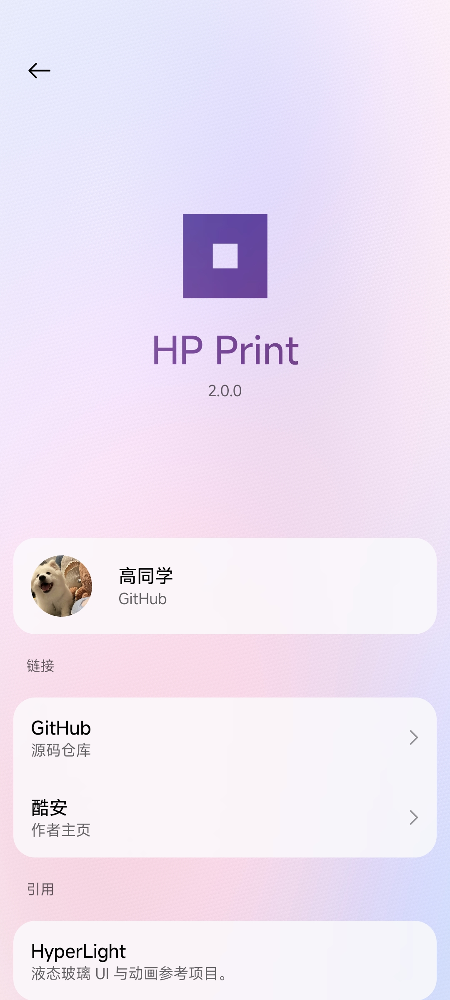

# 🖨️ HP Print

**一款为惠普打印机重新设计的 Android 打印客户端**

惠普官方的打印机软件太难用了，于是我自己重新写了一个——采用 MIUI 风格的现代化界面，功能强大、界面清爽，满足日常打印、扫描、证件处理的各种需求。

---

## ✨ 功能总览

| | 模块 | 说明 |
|---|------|------|
| 🏠 | **首页仪表盘** | 打印机状态（在线/离线/空闲/忙碌）、一键刷新、快捷操作、最近活动、墨水量监控 |
| 🖨️ | **打印** | PDF/Word/TXT/HTML/图片，双面、打印质量、逐页预览、照片尺寸排版、发票打印 |
| 🌐 | **网页打印** | 输入网址整页打印，或抓取正文去广告排版后打印 |
| 📷 | **扫描** | 手机相机文档扫描（实时边缘检测）、多页处理、滤镜、OCR 文字识别、导出 PDF |
| 🪪 | **证件工具** | 证件 1:1 打印、身份证正反面复印、证件照多张排版 |
| 📄 | **纸张模板** | 内置书法纸/格纸/笔记纸等 9 大类模板，参数自由调整 |
| 🖧 | **打印机管理** | 网络发现/手动添加、连接检测、状态轮询、墨水量详情 |
| 🎨 | **设置与个性化** | Miuix / Material 双风格、主题配色、检查更新、关于页 |
| ⚙️ | **底层能力** | IPP/SNMP/EWS 协议、多格式渲染引擎、原生扫描检测 + ML Kit OCR |

> 📋 完整功能清单见 [`docs/功能介绍.md`](docs/功能介绍.md)

---

## 🏠 首页（仪表盘）

- 默认打印机卡片：状态（在线/离线/空闲/忙碌/错误）、一键刷新、重命名
- 未添加打印机时的引导卡片，点击跳到添加流程
- 快捷操作：打印文档、打印照片、网页打印、扫描
- 最近活动：最近的打印任务及其状态
- 耗材（墨水量）：黑色/青色/品红/黄色/照片黑，低于阈值标「低」

## 🖨️ 打印

- 打印任务页：进行中任务 + 历史记录，支持「按日期 / 按格式」分类
- 文件选择：PDF、Word、TXT、HTML、图片（引擎另支持 OFD、PPTX、XLSX）
- 打印设置：打印机、份数、彩色/黑白、纸张尺寸、双面、打印质量、方向、打印范围
- 手动双面、打印预览、照片打印（一寸/二寸/身份证等尺寸）、电子发票（PDF/OFD）、网络文章打印

## 🌐 网页打印

- 直接输入网址打印整页网页
- 网络文章模式：只抓正文、去广告排版后打印

## 📷 扫描

- 手机相机文档扫描：单页/多页、超清/高清/标清、自动/手动裁边、实时边缘检测与取景框
- 拍后处理：四角微调、旋转、滤镜（原图/增强/灰度/黑白/去阴影）
- 多页文档：添加页面、单页裁切、删除、重命名
- OCR 文字识别（中文模型）：逐页识别、复制、分享、导出 TXT
- 导出 PDF、保存图片、直接打印；扫描历史分类筛选

## 🪪 证件类工具

- **证件打印**：扫描仪/摄像头/相册三种来源，自动检测边缘透视矫正，1:1 排版打印
- **身份证复印**：正反面分步扫描，带摆放引导，上下/左右排版
- **证件照排版**：选尺寸 + 相纸尺寸 + 背景色，生成多张排版后打印

## 📄 纸张模板

- 内置 9 大类模板：基础纸、书法纸、中文格纸、教育用纸、五线谱/音乐纸、笔记纸、计划表、特殊纸、其他
- 参数自由调整：纸张尺寸、颜色、线间距、边距、页数、水印、Logo
- 全屏预览（双指缩放/翻页），直接打印或保存 PDF

## 🖧 打印机管理

- 网络发现 + 手动添加（IP + 端口）
- 检查连接、设为默认、重命名、移除
- 详情：型号、连接方式、在线状态、墨水量；状态轮询监控

## 🎨 设置与个性化

- 界面风格双形态：Miuix / Material 一键切换
- 主题配色、检查更新（可开关）、关于页（版本/开发者/引用项目）
- 首次启动引导页

## ⚙️ 底层能力

- **打印协议**：IPP 打印、SNMP / EWS 状态与耗材读取、打印机扫描协议
- **文档渲染引擎**：PDF、DOCX、PPTX、XLSX、OFD、HTML、TXT、图片
- **扫描引擎**：原生检测库 + ML Kit 中文 OCR + 透视变换/裁边/滤镜
- **本地存储**：打印任务、扫描件、多页文档、纸张模板配置

---

## 📸 界面预览

**主页与打印**

**扫描与证件**

**关于**

---

## 📥 下载安装

最新安装包在 [Releases](https://github.com/gaotongxue-09/hp-print/releases) 页面，下载 `.apk` 文件后在手机上安装即可（需允许「安装未知来源应用」）。

---

## 🐛 问题反馈（Bug 报告）

使用中如果遇到**闪退、连不上打印机、打印/扫描异常、界面显示错误**等问题，欢迎反馈，我会尽快处理。

### 怎么反馈

1. 打开问题反馈页：[Issues](https://github.com/gaotongxue-09/hp-print/issues)
2. 点击绿色的 **New issue** 按钮
3. 选择 **Bug report / 问题反馈**，按表单填写
4. 点击 **Submit new issue** 提交

### 请尽量提供以下信息（方便快速定位问题）

- **App 版本**：在「设置 - 关于」里查看，或直接看安装包文件名（如 v2.0.0 / 40000）
- **手机信息**：机型 + 安卓版本（例如：小米14 / Android 14）
- **打印机型号**：例如 HP LaserJet M1136
- **问题现象**：清楚描述出了什么问题，以及期望的正常表现
- **复现步骤**：1. 打开… 2. 点击… 3. 出现…（能稳定复现最好）
- **从什么时候开始**：第一次使用就有，还是更新某个版本后才出现
- **截图或录屏**：能附上最好
- **崩溃日志**：如有报错弹窗或日志，一并贴上

### 功能建议

功能建议同样欢迎，在 [Issues](https://github.com/gaotongxue-09/hp-print/issues) 里选择 **功能建议 / Feature request** 提交即可，标题标注「建议」。

> 提交前可以先在 Issues 里搜索一下，看看是否已经有人反馈过相同问题，避免重复。

---

## 📄 文档

- [完整功能清单](docs/功能介绍.md)
- [安全性设计](docs/安全性设计.md)
- [关于](docs/关于.md)
- [更新日志](CHANGELOG.md)
- [安全漏洞上报](SECURITY.md)
